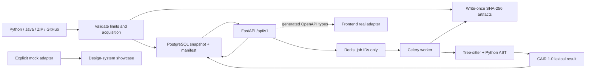

# System overview

Python 3.13/FastAPI/Pydantic/SQLAlchemy/Alembic/PostgreSQL are the persistence/API boundary. Redis/Celery performs longer GitHub/preprocessing work. Tree-sitter and Python AST provide lexical evidence only. Imported code is never executed. Full dependency pins are in pyproject.toml/requirements.lock; installed frontend versions are exact in package.json/package-lock.json. Transformers/PyTorch are reserved for authorized model work and are deliberately not downloaded now.

Backend modules have separate responsibilities: ingestion, GitHub transport, content-addressed storage, contracts, ORM, orchestration, API. Future `nlp/` and `documentation_engine/` are documented boundaries, not pretend implementations. The frontend is React 18/Vite/strict TypeScript with the original specified libraries. M2–M7 remain gated.

Development supports inline jobs for demonstration. Production-oriented execution uses separate API and bounded Celery workers with shared artifact storage and PostgreSQL. PostgreSQL row locking serializes duplicate deliveries; immutable snapshots and stable job ids prevent reprocessing drift. Local SQLite tests do not claim to validate row-lock behavior; the PostgreSQL integration test does.
